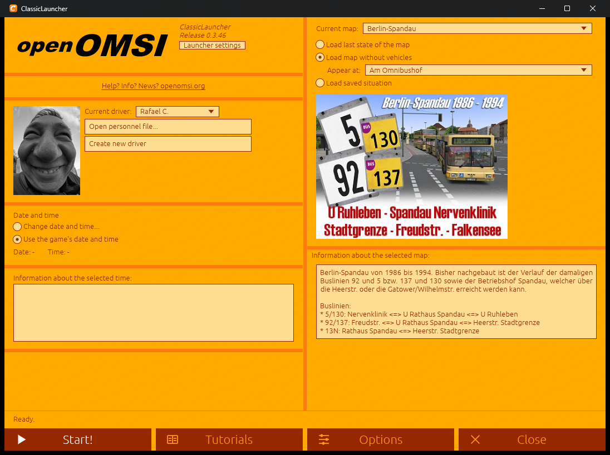
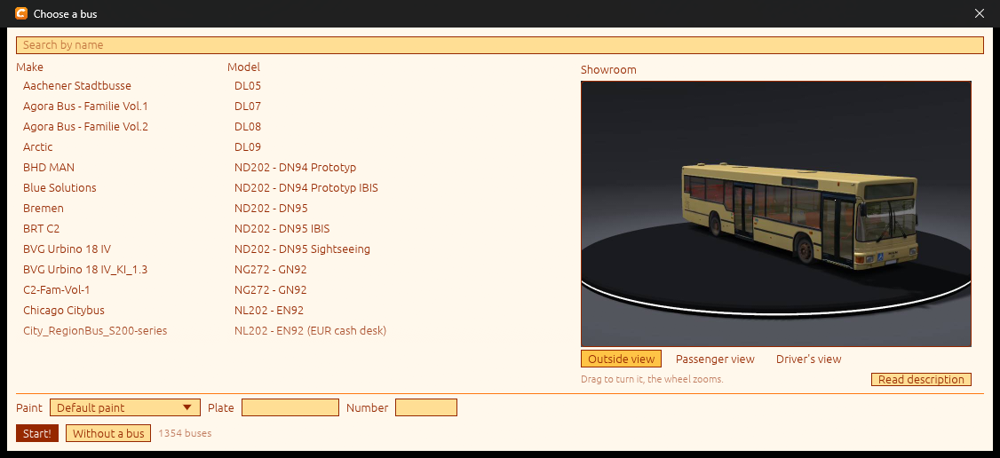
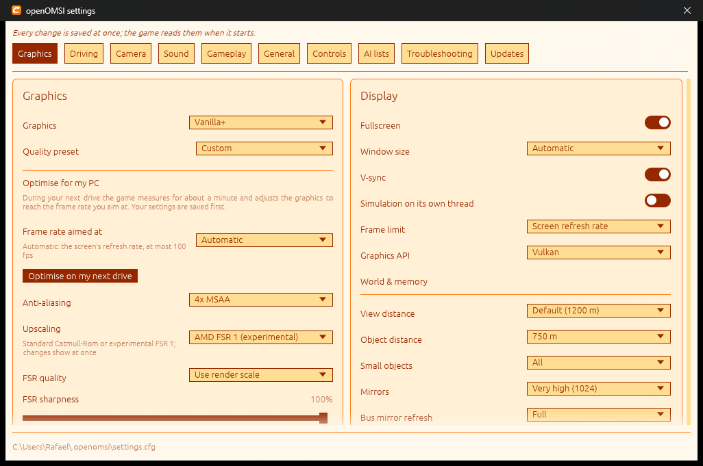

<p align="center"></p>

# ClassicLauncher

**Disfruta de [openOMSI](https://github.com/openOMSI-org/openOMSI) con un menú más clásico.**

ClassicLauncher es una pantalla de inicio pequeña y rápida para openOMSI, con el espíritu de la de OMSI 2: eliges el mapa, dónde
apareces, el conductor, la fecha y la hora, y empiezas. Todo lo que se puede configurar de openOMSI está a un clic en la misma
ventana, y no se cambia nada de tu instalación de OMSI 2.

*Beta: versión 1.0-beta2. Windows 10/11 (64 bits).* · [Sitio web](https://rafaelkaiz.github.io/ClassicLauncher/) · [Read in English](README.md)

<p align="center">
<a href="docs/img/start.png"></a>
<a href="docs/img/bus-picker.png"></a>
<a href="docs/img/settings.png"></a>
</p>

> ClassicLauncher es un proyecto independiente. openOMSI es otro proyecto, de sus autores, y OMSI es propiedad de sus dueños; este
> launcher no está afiliado a ninguno. Solo inicia `openomsi.exe` y edita los archivos que el propio juego lee.

## Qué hace

- **La pantalla de inicio clásica.** Mapa, «aparece en» (los lugares de inicio del propio mapa), último estado del mapa o una
  situación guardada, conductor y expediente del personal (con los textos y el diseño de OMSI), fecha y hora, tráfico y pasajeros.
  *¡Iniciar!* pregunta si quieres añadir un autobús.
- **Elegir autobús como en OMSI 2.** Marca, modelo y repintado salen del `[friendlyname]` de cada autobús, con matrícula y número de
  flota, la descripción del autobús en tu idioma y una **exposición 3D dibujada por el propio motor de openOMSI** (vistas exterior,
  pasajeros y conductor). Se dejan fuera remolques, copias del tráfico y lo que no es un autobús.
- **Las páginas de openOMSI, una a una.** *Opciones* ofrece Ajustes, Controles, Preparación, Complementos, Horario, Mods, Partidas en marcha,  Multijugador y Cochera; cada una abre esa página del launcher de openOMSI sola, en una ventana propia (hace falta una versión de  openOMSI que acepte `--page` y `--no-sidebar`).
- **Arranca en ventana normal**, F11 para pantalla completa. **Ventanas propias.** Los diálogos y selectores son ventanas de verdad: se mueven a donde quieras y el launcher nunca las corta.
- Tres temas (naranja de OMSI 2, oscuro, claro) y nueve idiomas: español, inglés, alemán, polaco, checo, francés, portugués, húngaro y serbio. Las pantallas
  y los ajustes están traducidos en todos; los textos de todos los idiomas salvo el español y el inglés no los ha revisado ningún hablante nativo, así que se agradecen correcciones.
  Se pueden añadir más idiomas con un archivo de texto (`%APPDATA%\ClassicLauncher\lang`).

## Instalación

Descarga `ClassicLauncher-<versión>-windows-x64.zip` de las [versiones](https://github.com/rafaelkaiz/ClassicLauncher/releases),
descomprímelo donde quieras (encuentra `openomsi.exe` solo o te lo pide) y ejecuta `classic-launcher.exe`. Sin instalador.

## Compilar

```
cargo build --release
cargo test --release
```

Rust, edición 2024. Usa egui/eframe y las API de Windows (DirectInput, los diálogos de archivos, y `curl.exe` y `tar.exe` que traen
Windows 10/11).

**Linux:** todavía no. La lectura de mandos, los diálogos de archivos, el manejo de procesos y el instalador de actualizaciones son
hoy solo de Windows; una versión para Linux necesita esas partes escritas para él.

## Licencia

GNU General Public License v3.0 o posterior. Véase [LICENSE](LICENSE).
