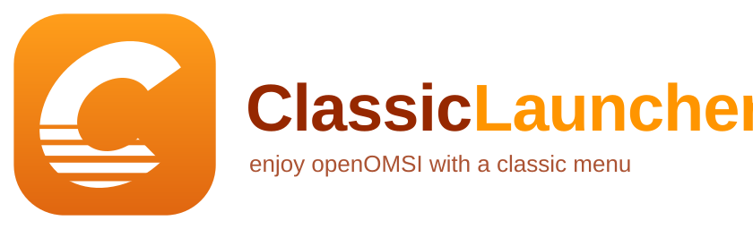
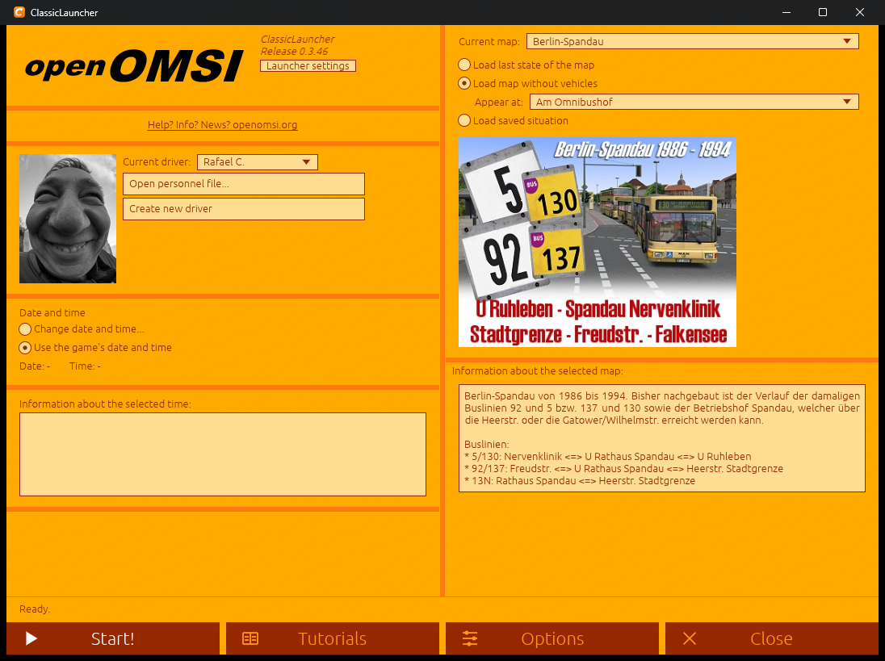
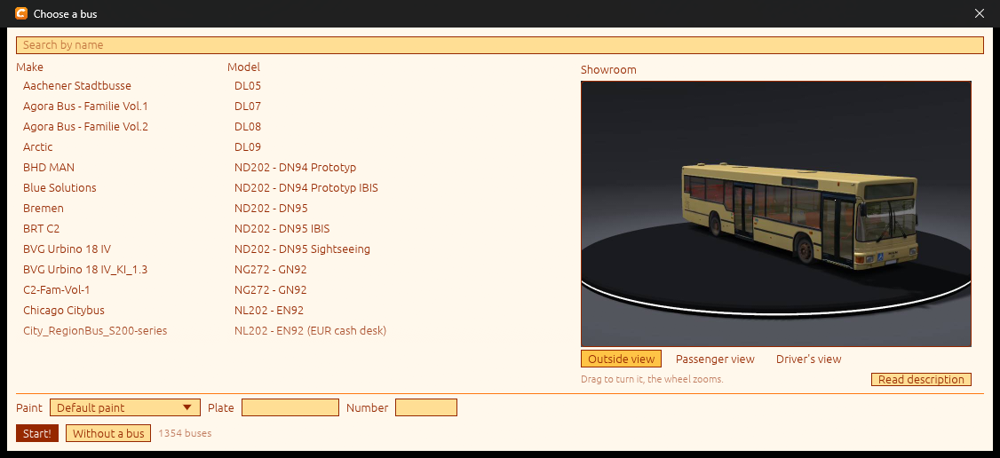
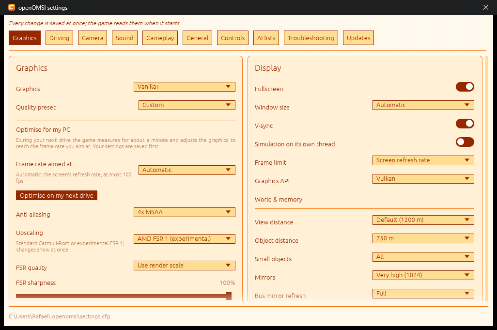

<p align="center"></p>

# ClassicLauncher

**Enjoy [openOMSI](https://github.com/openOMSI-org/openOMSI) with a more classic menu.**

ClassicLauncher is a small, fast start screen for openOMSI in the spirit of OMSI 2's own: pick the map, where you appear, the driver,
the date and time, and start. Everything openOMSI can be set up with is one click away in the same window, and nothing in your
OMSI 2 installation is changed.

*Beta: version 1.0-beta2. Windows 10/11 (64 bit).* · [Website](https://rafaelkaiz.github.io/ClassicLauncher/) · [Leer en español](README.es.md)

<p align="center">
<a href="docs/img/start.png"></a>
<a href="docs/img/bus-picker.png"></a>
<a href="docs/img/settings.png"></a>
</p>

> ClassicLauncher is an independent project. openOMSI is a separate project by its own authors, and OMSI is the property of its
> owners; this launcher is not affiliated with either. It only starts `openomsi.exe` and edits the files the game itself reads.

## What it does

- **The classic start screen.** Map, "appear at" (the map's own start places), last state of the map or a saved situation, driver
  and personnel file (with OMSI's own texts and layout), date and time, traffic and passengers. *Start!* asks if you want to add a bus.
- **Choose a bus like in OMSI 2.** Brand, model and repaint from each bus's `[friendlyname]`, plate and fleet number, the bus's
  description in your language, and a **3D showroom drawn by openOMSI's own renderer** (outside, passenger and driver views).
  Trailers, traffic copies and non-buses are left out.
- **All of openOMSI's settings**, in the same tabs as the game's page, saved at once (graphics presets, profiles, the
  "optimise for my PC" run, radio stations, ...).
- **Controls.** Keyboard bindings with filter, key capture and conflict warnings; game controllers (wheels, pedals, gamepads) read
  through DirectInput like the game, with live axis bars, step-by-step setup, buttons by action or by button (press to detect),
  dead zone, pedal strength, force feedback tuning and a **force feedback direction test**.
- **AI lists.** The map's traffic groups with their weights, the depot's bus types with fleet numbers, plates and repaints, and
  the bus types of each line.
- **Troubleshooting.** The game's own model test (`--check`) on any bus, map, file or folder.
- **openOMSI updates.** Stable or beta channel, any version to choose from, SHA-256 check, a trial run of the new program before it
  replaces anything, and a rollback if something fails.
- **Starts in a normal window**, F11 for full screen. **Windows of their own.** Dialogs and pickers are real windows: they can be moved anywhere, never cut off by the launcher.
- Three themes (OMSI 2 orange, dark, light) and nine languages: English, Spanish, German, Polish, Czech, French, Portuguese, Hungarian and Serbian. The main
  screens and settings are translated in all of them; the texts in all languages except English and Spanish have not been reviewed by native speakers, so corrections are welcome.
  More languages can be added with a text file (`%APPDATA%\ClassicLauncher\lang`).

## Install

Download `ClassicLauncher-<version>-windows-x64.zip` from the [releases](https://github.com/rafaelkaiz/ClassicLauncher/releases),
unzip it anywhere (it finds `openomsi.exe` by itself or asks for it) and run `classic-launcher.exe`. No installer.

## Build

```
cargo build --release
cargo test --release
```

Rust 2024 edition. It uses egui/eframe and the Windows APIs (DirectInput, the file dialogs, `curl.exe` and `tar.exe` that come with
Windows 10/11).

**Linux:** not yet. The controller reading, the file dialogs, the process handling and the update installer are Windows-only today;
a Linux build needs those parts written for it.

## Licence

GNU General Public License v3.0 or later. See [LICENSE](LICENSE).
